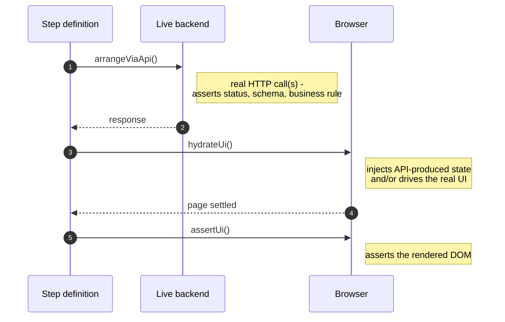
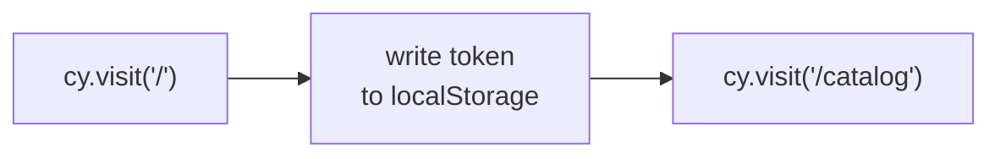
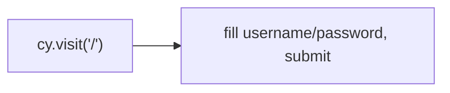
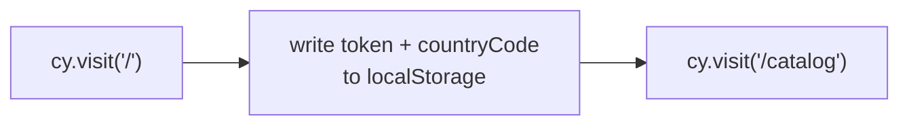
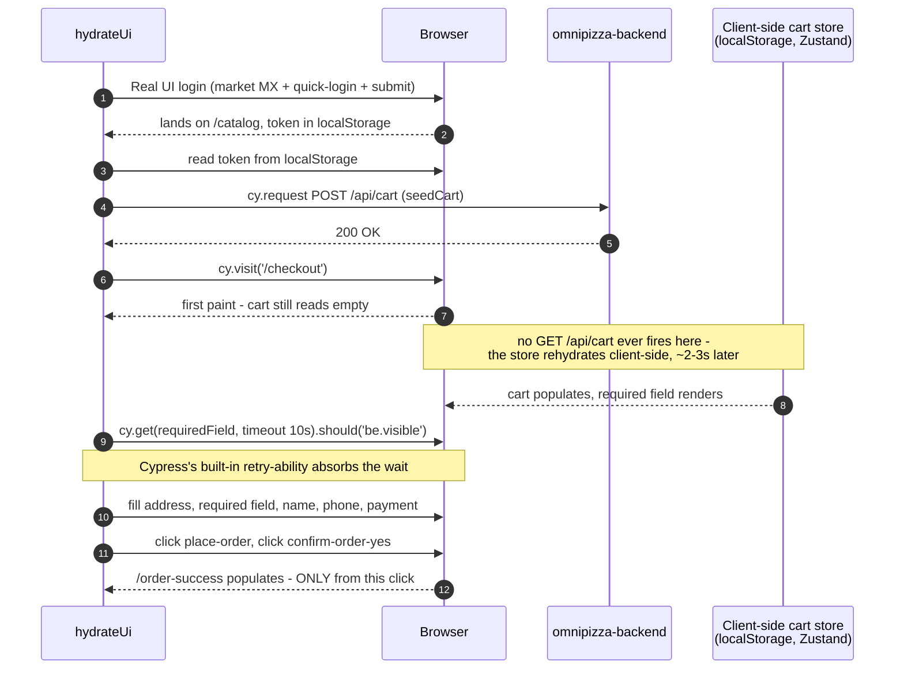
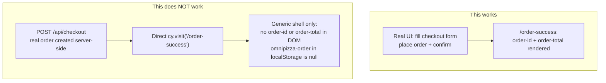
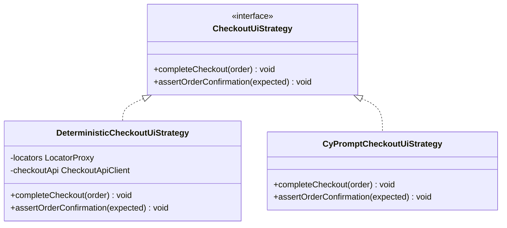
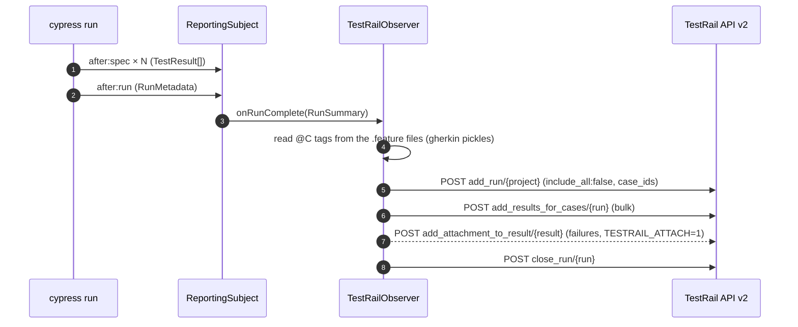

# cypress-conf-2026

An atomic-testing framework built for Cypress Conf 2026, testing a real, independently deployed
system — [OmniPizza](https://gsanchezm.github.io/OmniPizza/) — end to end. Every test proves the API
contract, hydrates that API-produced state into the UI, and asserts the rendered DOM, all in one
atomic run: no hidden coupling between "the API suite" and "the UI suite."

- **Frontend under test:** https://omnipizza-frontend.onrender.com
- **API under test:** https://omnipizza-backend.onrender.com (`/api/docs` for Swagger)

## Status

| Slice | Status |
|---|---|
| Core framework (`AtomicScenario`, `BaseApiClient`, `LocatorProxy`, Observer reporting) | ✅ Done |
| Auth & Session | ✅ Done |
| Market & Catalog i18n (5 markets: MX/US/CH/JP/SA) | ✅ Done |
| Cart & Checkout (multi-country, 5 markets: US/MX/CH/JP/SA) | ✅ Done |
| Orders & edge cases | ❌ Out of scope (decision made 2026-08-19) — see below |
| `cy.prompt` suite (`UI_STRATEGY=cyPrompt`, Checkout only) | ✅ Five markets passed in recorded Cypress Cloud run 7 on 2026-10-19; TestRail R7 closed with 5 passed |
| Assertion-budget refactor (1 API claim + 1 UI claim per scenario) | ✅ Done — re-verified live 2026-08-21, 12/12 (auth 2, catalog 5, checkout 5) |
| Foundations: enriched Observer (error/attempts/screenshots/labels + cause), cy.prompt budget guards, CI `check` job + opt-in recording, `pnpm warmup` | ✅ Done — verified live 2026-09-02, 12/12 deterministic; cy.prompt verified 2026-10-19 |
| Self-healing locators without an LLM (`HEAL_LOCATORS=a11y`) + "break the app, not the JSON" (`MUTATE_DOM`) | ✅ Done — live-verified 2026-09-02, matrix below (checkout 5/5 ×3, 5/5 fail ×1 by design); full suite without flags 12/12 |

The description above is the framework's design contract, and it's a live-verified one — Auth, Catalog
and Checkout (all 5 markets) all pass under real `cypress run` executions against the live app, not
just direct browser automation, and were re-run after the assertion-budget refactor rewrote what each
scenario asserts (2026-08-21: 12/12). An earlier version of this README noted that this workstation's
outbound
HTTPS to the OmniPizza hosts was broken for `cypress run`/`curl`/Node `https` alike - that was Kaspersky
intercepting the local Cypress process tree, not a real API outage, and it was fully resolved by
uninstalling Kaspersky (2026-08-20). `cypress open`/`cypress run` both work normally now.

**Orders is deliberately out of scope.** Live testing confirmed the OmniPizza frontend has no
order-history page (`/orders` redirects to `/catalog`) and no cancel UI anywhere — including
`/order-success`, which was confirmed to be a frozen snapshot from the moment an order is placed: an
order cancelled via the API afterward still renders as "out for delivery" on reload, with no dynamic
status awareness at all. The API itself is fully verified (`GET /api/orders`, cancel `409` on a second
attempt, `403` on cross-user access), but since this framework's whole thesis is that every test proves
both the API and the UI in one atomic run, there is no honest way to build Orders as a
`AtomicScenario`-shaped slice — it would need to fake a UI assertion. Decision: skip it rather than
compromise the pattern.

Checkout's 5 markets were each verified live before code was written against them: route names,
form-submission flow, exact API field values, and per-market rendered total-text formatting (plain
ASCII for US/MX, a no-break space for CH, comma-grouped fullwidth yen for JP, RTL marks + Arabic-Indic
digits for SA) all came from direct browser inspection, never assumed. Each scenario places two real
orders against the live backend (one via `arrangeViaApi`, one via the UI in `hydrateUi`) under the same
deterministic user — 10 orders per full Checkout run. Fine for a demo/free-tier deploy; worth knowing
before scaling the matrix further.

`DeterministicCheckoutUiStrategy.completeCheckout()` seeds the cart via API (`CheckoutApiClient.seedCart`)
instead of clicking catalog's "add to cart" button — live-verified 2026-08-20 that a `cy.request()`-seeded
cart (Node-side, the same mechanism used here) renders correctly on `/checkout` after a real UI login,
so re-driving catalog's add-to-cart UI here would be redundant with `CatalogFacade`'s own suite, not
additional coverage. The checkout **form** itself (address, required field, name, phone, payment,
place-order, confirm) still runs through real UI interaction — `/order-success`'s order-id/order-total
only populate from that real submit, live-confirmed to be unreachable via API-placed order + direct
navigation (the client-side order store stays empty, so those elements never render). `/checkout`'s cart
also renders empty on first paint and populates a moment later — a client-side store rehydration, not a
network fetch — so the required-field check after the API seed needs headroom beyond Cypress's default
4s command timeout. `CyPromptCheckoutUiStrategy` is untouched by this — it still drives catalog's
add-to-cart through natural language, since its whole premise is exercising the AI-resolved UI path.

**The `cy.prompt` suite covers Checkout only** (spec §10 names only `CyPromptCheckoutUiStrategy` — no
cy.prompt work for Auth/Catalog, to keep the free-tier prompt budget small). Every `checkout.feature`
scenario can run through `DeterministicCheckoutUiStrategy` (the default — `LocatorProxy` + `cy.get()`)
or `CyPromptCheckoutUiStrategy` (Cypress's AI-native `cy.prompt()`, one batched call per business
action), selected via `Cypress.expose('UI_STRATEGY')`:

```bash
CYPRESS_RECORD_KEY=<key> pnpm exec cypress run --spec cypress/e2e/checkout/checkout.feature --expose UI_STRATEGY=cyPrompt --browser chrome --record
```

**The prompt text is not in the TypeScript.** It lives in
[`src/features/checkout/prompts/checkout.prompt.md`](src/features/checkout/prompts/checkout.prompt.md),
one `##` section per strategy method or country-specific field, with rationale next to the steps —
editable by anyone who can read English, without touching code. esbuild's text loader
(`loader: { '.md': 'text' }` in `cypress.config.ts`) turns the import into a plain string at bundle
time, so `CyPromptCheckoutUiStrategy` stays synchronous; `cy.fixture`/`cy.readFile` would have forced a
`Chainable` through the whole `CheckoutUiStrategy` interface.

That move opens a hole, and `preparePrompt()` closes it. Inline, a renamed placeholder was a compile
error. In a markdown file, it's invisible — `cy.prompt()` would receive the literal `{{addres}}`, hand it
to the model, and the AI would improvise something plausible, producing a *silently wrong* test rather
than a failing one. So `preparePrompt()` cross-checks `{{token}}`s against supplied values in both
directions and throws on either mismatch. It also rejects obsolete single-brace placeholders before
`cy.prompt()` runs. The earlier `node:test` coverage was removed with the other Node test files;
`pnpm test:unit:node` currently executes zero tests.

Locally this needs `cypress open`/`cypress run` while logged into Cypress Cloud, or `cypress run
--record` with the project's record key; in CI it's `.github/workflows/cy-prompt-suite.yml`
(`workflow_dispatch` only, never on push/PR). **What a run costs** — verified against the Cypress
Cloud FAQ and pricing page on 2026-09-02, replacing an earlier "100 prompts/hour" claim that was
wrong (and that slide 18 of the deck still repeats):

- Since **2026-08-01** `cy.prompt` is metered per **execution**: every `cy.prompt()` command that
  runs — open or run mode, cache hit or not — counts as one, however many steps it batches. Attempts
  that fail on authentication, network or a malformed prompt do not count.
- The free **Starter** plan includes **100 executions per month** (and 500 recorded test results per
  month); Team starts at 9k executions a year. Over the limit on Starter, self-healing and new prompt
  creation switch off for the rest of the billing cycle — no surprise bill, just a suite that quietly
  stops being AI.
- This suite makes exactly **2 calls per scenario × 5 markets = 10 executions per run**.
  **That is 10 runs per month on Starter, rehearsals included** — and a Cypress
  retry re-runs the scenario's `cy.prompt()` calls, so a flaky market costs extra.
- The "100 prompts / 500 steps per hour" figures are per-user caps that apply **only to runs not
  recording to Cloud**; `cy-prompt-suite.yml` records, so the monthly quota is what governs it.
- Generated code is cached **in Cypress Cloud** — there is no local cache folder — and shared across
  machines and CI. Editing any step in `checkout.prompt.md` invalidates the cache and forces a fresh AI
  call on the next run; placeholder *values* never reach the model and never invalidate it. Freeze the
  prompt text before rehearsing. A section may not exceed 50 steps (Cypress's per-call limit);
  `parsePromptDocument` throws above that.

**Recorded `cy.prompt` run:** the workflow runs all five Checkout examples and can execute two
prompts per example, plus retries. For one example locally, add `--env tags=@C9 --config retries=0`:

```bash
# Local, recording:
CYPRESS_RECORD_KEY=<key> pnpm exec cypress run --spec cypress/e2e/checkout/checkout.feature --expose UI_STRATEGY=cyPrompt --browser chrome --record
# Or in CI:
gh workflow run cy-prompt-suite.yml
```

The first recorded workflow run failed because Cypress requires `{{placeholder}}`. After correcting
the syntax and giving each country an explicit delivery-detail target, a local recorded run passed
all five Checkout markets: [Cypress Cloud run 7](https://cloud.cypress.io/projects/5v45hh/runs/7).
The TestRail observer reported and closed R7 with five passed results.

### Cypress Cloud CLI

`@cypress/cloud` is installed as a pnpm dev dependency. Use `pnpm cloud:status` to check CLI
authentication and `pnpm cloud:runs` to list this project's runs. The CLI needs a separate Cypress
Cloud login or a `CYPRESS_CLOUD_TOKEN` personal access token; `CYPRESS_RECORD_KEY` authenticates
recorded Cypress runs only. An organization administrator may also need to enable the CLI integration
in Cypress Cloud. Keep tokens in the local ignored `.env` or a secure environment store; for a token
in `.env`, run `pnpm exec dotenvx run -f .env -- pnpm cloud:status`. Interactive login is
`pnpm exec cy-cloud login`.

### Break the app, not the JSON — three healers, one renamed attribute

The earlier version of this demo (`BREAK_LOCATOR`) swapped one *registry* value for a selector no app
ships. That proved the deterministic path is coupled to `checkout.locators.json` — and nothing more,
because `cy.prompt` never reads that file. The claim a slide actually wants to make is *"the test
survives a change to the app"*, and that needs the app to change. So now it does:

```bash
# (ii) The app changes, the registry does not. After /checkout renders, the real data-testid on the
#      address input is renamed address-desktop -> address-desktop--renamed-by-demo. Deterministic path: fails.
#      On stage add --config retries=0: with the CI default (runMode: 2) the five failures take ~1:40, not ~0:35.
pnpm exec cypress run --browser chrome --spec cypress/e2e/checkout/checkout.feature --expose MUTATE_DOM=checkout.address

# (iii) Same run, plus the LLM-free healer. Passes; the command log names the tier that healed.
pnpm exec cypress run --browser chrome --spec cypress/e2e/checkout/checkout.feature --expose MUTATE_DOM=checkout.address,HEAL_LOCATORS=a11y

# (iv) The registry-only break still exists, and the healer handles it the same way.
pnpm exec cypress run --browser chrome --spec cypress/e2e/checkout/checkout.feature --expose BREAK_LOCATOR=checkout.address,HEAL_LOCATORS=a11y
```

Nothing in the test code changes between these commands. `cypress/support/e2e.ts` picks the
`SelectorSource`; `MUTATE_DOM` is a one-line hook after each screen's ready guards
(`mutateDomIfRequested(this.locators, 'checkout')` in `DeterministicCheckoutUiStrategy`, the same in
the Auth and Catalog facades); `HEAL_LOCATORS=a11y` wraps the source in a third Decorator,
`A11yFallbackSelectorSource`, outside `BrokenSelectorSource`. Passing `BREAK_LOCATOR` and `MUTATE_DOM`
together throws — they are two versions of the same demo, and a key no slice registers throws too,
for the same reason as before: a demo that silently breaks nothing is the worst outcome on stage.

**How a synchronous selector source can heal.** `SelectorSource.get()` still returns one selector
string, synchronously — the 2025 retrospective below is the reason that must not change. What was
added is `candidates(key)`: an ordered list, registry first, and one Cypress-side primitive,
`locate(source, key)` (`src/core/ui/locate.ts`), that at command run-time picks the first tier
matching **exactly one** element and yields a normal `cy.get(chosen)`. With no healer wired every key
has one candidate and `locate` *is* `cy.get(selector, options)` — the deterministic command stream is
unchanged, which is what row (i) below and the 12/12 full-suite run re-verify. With more than one
candidate the choice is made inside a `.should()` guard, so it retries with Cypress's own loop (a
form that renders 2–3 s late still resolves) and the chosen selector is handed to a normal `cy.get`,
so `.type()`/`.click()`/`.should()` keep their retry-ability. Two-or-more matches is ambiguous and
skipped, never picked: typing into the wrong input would pass `fillField`'s own guard and fail three
commands later as a mystery.

The tiers, in order (`src/core/locators/fallbackTiers.ts`): registry `data-testid` → `id` → `name` →
`aria-label` → `placeholder` → `title` → `role` → `input[type]` → innermost element containing the
visible text. Only CSS/jQuery-expressible tiers, so the healed element goes through `cy.get` with full
retry-ability. No LLM, no network, no Cloud quota, sub-second.

**The map is harvested, not written.** `pnpm harvest:locators` runs a headless spec
(`cypress/harvest/locators.harvest.cy.ts`, outside the e2e pattern so CI never sees it) that logs in
per market, walks login → catalog → checkout → order-success, and records the attributes above for
every non-templated registry key into `src/features/<slice>/locators/<slice>.fallbacks.json`. Five
markets, five real orders. A localized attribute is stored once per market; only the rendered
market's value can match, so the other four cost nothing.

**Saudi Arabia (RTL) heals through exactly the same tiers.** The Arabic values live in the same lists
as the English, Spanish, German and Japanese ones, byte for byte as the DOM holds them. In run (iii)
the SA scenario healed via `id [id="field-address"]` — and so did the other four markets, through the
identical selector, because `id` is the first fallback tier and the app's `id` is locale-free. The
Arabic placeholder (`123 شارع الفخامة`) sits three tiers further down and was never consulted; it is
the tier that would carry SA if the `id` went too, and the harvest already holds it. Nothing in the
healer knows what a market is, what direction the text runs, or which script it is written in.

**Results (2026-09-02, Chrome, live app, all under the cross-worktree lock):**

| # | `--expose` | Result | Evidence (`cypress/reports/demo-trail.log`) |
|---|---|---|---|
| i | *(none)* | 5/5 pass, `All specs passed!` (00:24) | file not created — nothing healed, nothing mutated |
| ii | `MUTATE_DOM=checkout.address` | 5/5 **fail**, `1 of 1 failed (100%)` (00:33), every scenario `Timed out retrying after 4000ms: Expected to find element: [data-testid="address-desktop"], but never found it` | 5× `[mutate-dom] checkout.address: renamed data-testid "address-desktop" -> "address-desktop--renamed-by-demo" on 1 element(s); the registry still says [data-testid="address-desktop"]` |
| iii | `MUTATE_DOM=checkout.address,HEAL_LOCATORS=a11y` | 5/5 pass, `All specs passed!` (00:22) | 5× `[mutate-dom] …` + 5× `[heal] checkout.address: registry [data-testid="address-desktop"] matched no single element; healed via id [id="field-address"]` — US, MX, CH, JP and SA alike |
| iv | `BREAK_LOCATOR=checkout.address,HEAL_LOCATORS=a11y` | 5/5 pass, `All specs passed!` (00:22) | 5× `[heal] checkout.address: broken [data-cy-broken-locator="checkout.address"] matched no single element; healed via id [id="field-address"]` |

React did not restore the renamed attribute in (ii): all five scenarios failed on the address step,
and the 4 s timeout in the error is `cy.get`'s own — the deterministic path really did lose the
element. The full logs of each row are kept locally under `docs/superpowers/reports/` (git-ignored),
together with the `demo-trail.log` snapshots of rows (iii) and (iv)
(`2026-09-02-healing-demo-trail-{iii,iv}.log`), so the heal lines quoted above can be re-read.

Harvested tiers for `checkout.address` (`src/features/checkout/locators/checkout.fallbacks.json`):

```json
"checkout.address": {
  "id": ["field-address"],
  "placeholder": ["123 Luxury Avenue", "Av. Reforma 123", "Musterstraße 123", "東京都渋谷区...", "123 شارع الفخامة"],
  "inputType": ["text"]
}
```

`cy.log` never reaches the terminal in `cypress run`, so every heal and mutation is narrated twice:
`logStep` for the command log / Test Replay / `cypress open` (the stage), and one line appended to
`cypress/reports/demo-trail.log` via `cy.writeFile` for anyone reading a headless run afterwards (no
`cy.task`, so `cypress.config.ts` is untouched). The file accumulates across runs — each line carries
its timestamp and scenario title — so clear it before a demo whose counts matter.

> **What this proves now.** (ii)+(iii) prove the deterministic path fails on a *real DOM change* and
> the a11y healer recovers from it by semantics; (iv) proves the same healer covers the registry-only
> break. What it still does not prove is `cy.prompt` surviving (ii) — that is one billed Cloud run,
> and the `MUTATE_DOM` hook is one call away in `CyPromptCheckoutUiStrategy` for whoever triggers it.

**Known limits.** Templated keys (`login.marketButton`, `login.quickLoginButton`) are interpolated by
the facade after `get()` and are neither harvested nor healed. `catalog.allPizzaPrices` matches many
elements by design and heals nothing. Explicit `role`/`aria-label` attributes only — implicit ARIA
roles need the accessibility tree, which nothing in a headless run exposes (`cypress tap aria` is
open-mode only). A heal is narrated, never written back into the registry. The harvest records the
visible text of `orderSuccess.orderId` (`#ORDER-…`) as its `text` tier, and that value is unique to the
order the harvest placed, so it can never match a later run and re-harvesting churns those five
strings (verified 2026-09-02: `pnpm harvest:locators` on a committed map diffs only there); the key
still heals through nothing but its registry selector, which is unchanged.

The two-pair `--expose A=x,B=y` syntax above is verified separately, so the billed run can't be lost to
a flag-parsing mistake: `--expose UI_STRATEGY=deterministic,BREAK_LOCATOR=checkout.address` failed all
5 markets on `[data-cy-broken-locator=...]`, which only happens if **both** pairs parsed — had the
second been swallowed, the run would have passed 5/5.

## The agentic loop

The deterministic suite runs without an LLM. Claude, Codex, and Copilot can work on the same
versioned tests through the [provider-neutral contract](AGENTS.md); Claude's hooks and subagents
are an adapter, not a runtime dependency. GitHub Copilot also reads
[its repository instructions](.github/copilot-instructions.md). The
[interactive architecture map](.archify/architecture-agent-neutral-20261019/provider-neutral.html)
shows the executable core and optional integrations. Its source links point to baseline commit
`817141f`; the portability additions in this working tree are documented here. Three layers, each demonstrable
offline, without a model:

| Layer | Files | Demo without a model |
|---|---|---|
| **Guardrails** (deterministic) | `.claude/settings.json` → `scripts/hooks/*.ts` → `src/core/hooks/*.ts` | `echo '{"tool_name":"Edit","tool_input":{"file_path":"cypress/e2e/auth/auth.feature","old_string":"a","new_string":"b"}}' \| pnpm exec tsx scripts/hooks/guard-oracle.ts` → exit 2, "`auth.feature` is the oracle" |
| **Loop** (`cypress tap`) | `scripts/tap.ts` → `src/core/tap/{parseTapOutput,freshVerdict}.ts` | `pnpm tap:status` → `{"status":"not connected"}` with exit 0, even though Node 24 on Windows aborts every `cypress tap` call in libuv teardown (`Assertion failed: !(handle->flags & UV_HANDLE_CLOSING)`, exit `0xC0000409`) after the JSON has already been printed |
| **Triage** | `scripts/{flake-audit,triage-signals,triage-verdict}.ts`, `.github/workflows/claude-ci-triage.yml` | `pnpm flake-audit src/core/cloud/fixtures/cy-cloud-test-list.sample.json` → `flakyCount: 1`; `pnpm triage:verdict src/core/triage/fixtures/checkout-broken-locator.log` → JSON `selector_drift` verdict |

**Red → green without touching the mouse.** Terminal 1: `pnpm cy:open` (E2E, Chrome). Terminal 2:
`claude`, then `@agent-cy-fixer fix cypress/e2e/checkout/checkout.feature`. The subagent
([`.claude/agents/cy-fixer.md`](.claude/agents/cy-fixer.md), preloaded with the official `cypress-tap`
skill) runs `pnpm tap:run <spec>` — a baseline `status`, one `run`, then polling until a verdict whose
`startedAt` moved past the baseline — reads `reporter`, pins the failing command, reads `dom`/`aria`,
patches a step definition, a strategy or a `locators/*.json`, and reruns, at most five times, before
printing a one-line JSON verdict. Seed the failure with the same `--expose BREAK_LOCATOR=checkout.address`
the broken-selector demo uses, on the `cypress open` command line only, never in code. The PreToolUse
hook denies any edit to a `.feature`, or to an `assert*` method, a `.should(` or an `expect(` call in a
facade or strategy (exit 2, reason shown to the agent); `ALLOW_TEST_EDITS=1` is the human override. A
second PreToolUse hook denies `--record`, `UI_STRATEGY=cyPrompt` and `git push` outright. Both are pure
decision functions under `src/core/hooks/` with their own node tests; the scripts only read the hook
JSON from stdin.

**Use another agent.** Open the repository in Codex or GitHub Copilot and give it the same task:
“Read `AGENTS.md`. Diagnose `cypress/e2e/checkout/checkout.feature` with `pnpm tap:run`; repair only
the step, hydration strategy, or locator; run `pnpm typecheck` and the affected slice; report the
verdict.” The test runner and result reporters are the same. Claude's named subagents and automatic
hooks are conveniences specific to Claude Code; the equivalent instructions and scripts are in the
repository for other agents. A normal human terminal can run every deterministic command directly.

**Repo-level config** (`AGENTS.md` for the shared rules; [`CLAUDE.md`](CLAUDE.md), [`.mcp.json`](.mcp.json), `.claude/skills/` = the five
MIT `cypress-io/ai-toolkit` skills copied in, pinned by `skills-lock.json`): open Claude Code in a fresh
clone and the skills, hooks, subagents and MCP servers are already there. Cypress Cloud recording
works with the Record Key, while the Cloud MCP (`https://mcp.cypress.io/mcp`, OAuth via `/mcp`) and
Cloud CLI require separate authentication and may need an org admin to enable their integrations.
`pnpm cloud:status` currently reports `authenticated: false`, so use Cloud's UI or the recorded
fixtures for inspection until CLI access is configured. The GitHub
server is the read-only Actions toolset, authenticated with a `GH_MCP_PAT` environment variable that is
never committed.

**CI.** [`claude-ci-triage.yml`](.github/workflows/claude-ci-triage.yml) fires when *Deterministic suite*
fails (a push to `main` or a PR against it; `workflow_run` reads the triage file from `main`). It downloads failed job logs and screenshots and always creates a deterministic JSON verdict with
`pnpm triage:verdict`. If `ANTHROPIC_API_KEY` is configured, `claude-code-action@v1` can enrich that
verdict; without the secret the workflow uses the deterministic one. A flake or cold start at ≥ 0.7
reruns failed jobs (at most twice); other recognized categories produce a PR comment or issue.
An unknown signal stays in the job summary for human review. The verdict is a diagnosis aid, not a
strict product-bug proof; a tighter issue gate is a proposal for the talk. `cy.prompt` remains an
optional Cloud-backed AI demo, while the default Checkout strategy is deterministic.

## Architecture

Vertical slicing, not layered folders — each slice under `src/features/<slice>/` is independently
readable, demoable, and deletable:

```
cypress/
├── e2e/{auth,catalog,checkout}/*.feature   # Gherkin - pure business language, no "click"/"selector"/"API"
└── support/e2e.ts                           # composition root (browser-side DIP wiring)
src/
├── core/
│   ├── http/        BaseApiClient, ApiError, parseApiResponse (pure, Node-testable)
│   ├── ui/           AtomicScenario, runAtomicSteps (pure, Node-testable)
│   ├── locators/      LocatorProxy
│   ├── types/         shared contracts used by 2+ slices
│   ├── config/         shared constants (e.g. localStorage keys)
│   └── reporting/      Observer, ReportingSubject, ConsoleObserver, GithubActionsSummaryObserver
└── features/
    ├── auth/      {api, facade, data, steps, locators/*.json}
    ├── catalog/   {api, facade, steps, locators/*.json}
    └── checkout/  {api, facade, data, steps, strategies, locators/*.json}
```

### The atomic flow — `AtomicScenario`

Every scenario runs the same three steps, in this order, enforced by a Template Method:

```
1. arrangeViaApi()  → real API call(s) via BaseApiClient - asserts the API contract itself
                       (status, schema, business rule).
2. hydrateUi()       → injects that API-produced state into the browser (token/session, cy.visit).
3. assertUi()        → asserts the rendered DOM reflects that state.
```

```typescript
AtomicScenario.for('catalog').run({ arrangeViaApi, hydrateUi, assertUi });
```



### The assertion budget — one API claim, one UI claim

Every scenario makes **at most two assertions**: one about the API contract, one about the rendered
DOM. That isn't an arbitrary style rule — it falls straight out of the atomic thesis. If a scenario
proves the API and the UI in one run, then it has exactly two things to say, and anything beyond that
is a second test wearing the first one's clothes.

Making that countable needs a distinction the code enforces:

| | What it is | Mechanism | Counts toward the budget? |
|---|---|---|---|
| **Claim** | The product behaviour the scenario exists to prove | `expect()` / `.should()`, only inside an `assert*` method | Yes |
| **Precondition** | What must hold for the claim to mean anything (a token was issued, the response is for the market we asked for) | `precondition()` — throws `PreconditionError` | No |
| **Guard** | Waiting for the DOM to settle before reading it | `.should('be.visible')` on a ready marker | No |

`precondition()` throws rather than asserts, so a broken arrange step reads as *"Precondition not met:
the standard customer login issued an access token"* instead of masquerading as a product failure.
Guards still use `.should()` — that's how Cypress retries, and a `.then()` check would fail on anything
the app renders a tick late — so the invariant isn't "count `.should()` calls". It's: **every claim
lives in an `assert*` method on a facade or strategy; a `.should()` anywhere else is a guard by
construction.**

| Scenario | API claim | UI claim |
|---|---|---|
| Auth — standard login | *(none — this scenario is about the UI landing state)* | `pathname === '/catalog'` |
| Auth — locked out | login rejected with `403` | error text matches `/locked out/i` |
| Catalog (×5 markets) | envelope currency **and** every pizza's currency are exactly this market's ISO code | p01's rendered price is byte-for-byte `$227.97` / `￥2,051` / … |
| Checkout (×5 markets) | the placed order came back `pending` | `/order-success`'s total is byte-for-byte the API-computed total |

Two notes on how the reduction was done. Catalog's four API assertions collapsed into **one** rather
than three being deleted — envelope and per-item currencies fold into a single `Set`, so the
stale-item case a bare envelope check would miss is still caught. And **no scenario was split** to
meet the budget: a full Checkout run already places 10 real orders against a free-tier backend, so
splitting would have paid for assertion hygiene with live API load. The reduction came from removing
genuinely redundant claims, not from adding scenarios.

### How hydration works

"Hydrate" doesn't mean one fixed technique here - each slice's `hydrateUi` uses whatever the live app
actually allows, discovered by testing against the real DOM rather than assumed.

**Auth - standard login: pure injection.** There's nothing to prove about the login form itself in this
scenario - `arrangeViaApi` already proved the credentials work via the API, so `hydrateUi` just needs an
authenticated `/catalog` to assert against.



**Auth - locked-out: pure real UI.** A failure state can't be injected - the rendered error message only
exists if the real form is actually submitted with those credentials.



**Catalog: pure injection.** Writing `token` + `countryCode` to localStorage and doing a two-phase
`cy.visit()` genuinely reproduces an authenticated, market-selected `/catalog` - live-verified to work
reliably **only on a fresh boot** (no pre-existing `omnipizza-country` blob in localStorage). Cypress's
default `testIsolation: true` clears storage between every test, so this holds for the real suite even
though it looked broken the first time it was tried in a browser session carrying leftover state from
earlier manual testing.



**Checkout: a hybrid**, and deliberately so - see the full walkthrough below.

#### Checkout's hydration, step by step



Login stays real UI here (not injection, unlike Catalog) because the composition root wires
`DeterministicCheckoutUiStrategy` to run *after* `AuthFacade.loginViaUiWithMarket` in
`checkout.steps.ts` - reusing Catalog's injection trick would be a valid alternative (same fresh-boot
caveat applies) but was left as real UI so this slice still exercises the login form and market picker
once, deliberately, rather than nowhere.

The part that **cannot** be shortcut is the checkout form submission itself, because `/order-success` has
no server fetch to fall back on:



Live-verified 2026-08-20: placing a real order via `POST /api/checkout` and then navigating straight to
`/order-success` renders the generic "out for delivery" shell, but `order-id`/`order-total` never appear
in the DOM at all - they're written by whatever client-side action fires on the real "confirm order"
click, not fetched from the server. That's the one hard boundary this framework has found so far for
API-only hydration.

#### Method reference

| Method | Slice | What it does |
|---|---|---|
| `AuthFacade.hydrateSessionAndOpenCatalog(token)` | Auth | Pure injection: two-phase `cy.visit('/')` → write token → `cy.visit('/catalog')`. Used only by the standard-login scenario. |
| `AuthFacade.submitLoginFormAs(userKey)` | Auth | Real UI: fills username/password and submits. Used by the locked-out scenario, where the failure state can only be reproduced, not injected. |
| `CatalogFacade.openCatalogAuthenticated(token, countryCode)` | Catalog | Pure injection: two-phase visit, writes `token` + `countryCode` to localStorage. Works because the app's boot logic re-derives its full `omnipizza-country` Zustand blob from that plain key - but only on a fresh boot. |
| `CheckoutFacade.seedCartViaApi(...)` | Checkout | Called from `arrangeViaApi`, not `hydrateUi` - sets market, seeds the cart, fetches the enriched/priced cart to compute a real subtotal for the API-side order. |
| `CheckoutFacade.completeCheckoutViaUi(order)` | Checkout | Delegates to whichever `CheckoutUiStrategy` the composition root wired in - the step definition never knows which one is active. |
| `DeterministicCheckoutUiStrategy.completeCheckout(order)` | Checkout | Runs after the real UI login: reads the token, seeds the cart via `CheckoutApiClient.seedCart` (API), visits `/checkout` directly, then drives the real checkout form (address, required field, name, phone, payment, submit). |
| `DeterministicCheckoutUiStrategy.assertOrderConfirmation(expected)` | Checkout | Asserts `/order-success`'s rendered order-id/order-total match the API-computed expected order - only reachable after a real form submit. |
| `CyPromptCheckoutUiStrategy.completeCheckout(order)` | Checkout | Drives the entire flow, including "add to cart", through natural-language `cy.prompt()` steps - no API shortcut, since exercising the AI-resolved UI path end to end is this strategy's whole purpose. |



### Pattern map

| Pattern | Where | Why here |
|---|---|---|
| **Proxy** | `LocatorProxy` wraps `locators/*.json` | Dot-path selector lookup with caching; throws a clear error on a missing key instead of a silent `undefined`. Replaces classic POM. `candidates()` is the seam healing extends; `get()` stays synchronous and single-valued. |
| **Template Method** | `BaseApiClient.request()`, `AtomicScenario` | Fixes the algorithm skeleton; slices fill in only the specific steps. |
| **Facade** | `AuthFacade`, `CatalogFacade`, `CheckoutFacade` | One narrow entrypoint per slice, hides API+data+locator/strategy wiring from step definitions. |
| **Strategy** | (a) `CheckoutCountryStrategy` — per-country required-field/tip API key mapping, keyed by `CountryCode`. (b) `CheckoutUiStrategy` — one interface scoped at business-action granularity (`completeCheckout`/`assertOrderConfirmation`, matching `checkout.feature`'s `When` steps), with `DeterministicCheckoutUiStrategy` (`LocatorProxy` + `cy.get()`) and `CyPromptCheckoutUiStrategy` (`cy.prompt()`) implementations, selected via `Cypress.expose('UI_STRATEGY')`. | (a) 5 genuinely different required-field/tip rules (CH/JP reuse the same DOM field but different API keys). (b) Lets a step definition invoke the same checkout action via hardcoded locators or `cy.prompt()` without knowing which — scoped per business action, not per click, so `cy.prompt`'s multi-step batching isn't thrown away. |
| **Builder** | `CheckoutRequestBuilder` | Checkout payloads have several country-conditional fields (computed property names for the required-field/tip keys) — reads better as a fluent construction than a function with many optional args. |
| **Factory** | `UserFactory` (deterministic roster, loaded from `deterministicUsers.json`) | Centralizes how test data is built per slice. |
| **Observer** | `ReportingSubject` + `Observer` (per spec) and `RunObserver` (per run), wired on `after:spec` / `after:run` | Decouples "a spec finished" from "who cares" — `ConsoleObserver` and `GithubActionsSummaryObserver` are both genuine subscribers; mochawesome is wired as Cypress's native `reporter` config, not a third Observer. `TestRailObserver` is the run-level subscriber — see [TestRail](#testrail). |
| **Decorator** | `BrokenSelectorSource` wraps any `SelectorSource` | Breaks exactly one locator key while passing every other through untouched — the broken-selector demo is a wiring choice in the composition root, not a code change. (Kept as the registry-only variant - row iv of the matrix in [the demo section](#break-the-app-not-the-json--three-healers-one-renamed-attribute).) |
| **Decorator** | `A11yFallbackSelectorSource` wraps any `SelectorSource` | Appends harvested a11y fallback tiers to a key's candidates; `locate()` picks the first tier that matches exactly one element at command run-time. Composes outside `BrokenSelectorSource`. |
| **Adapter** *(minor)* | Cucumber step-definition layer | Thin adapter between Cucumber's step matching and our Facade interface. |

### What came over from the 2025 framework — and what didn't

[`cypress-conf-2025`](https://github.com/gsanchezm/cypress-conf-2025) shipped a `common/actions/`
layer: twelve `BaseAction` subclasses behind an `ActionRegistry`, dispatched by string through a
`Proxy` (`$loc.page.KEY.clickOnElement()`). Reviewing it for this year's framework turned up one thing
worth keeping and a cause-and-effect worth putting on a slide.

**Kept: `typeIfNotEmpty` → `fillField`.** 2025 re-typed through `cypress-recurse` until the input's
value matched the text, because a controlled React input can silently drop characters when a re-render
lands mid-type. This framework had five bare `.clear().type()` calls that would have surfaced such a
drop as a mystery failure at the assertion three commands later. `fillField` keeps the verification via
`.should('have.value', …)` — which retries the way `recurse` did, with no new dependency — and drops
the *"IfNotEmpty"* half: 2025 skipped empty text because SauceDemo had optional fields, but every field
here is required, so an empty value means broken test data and throws.

**It earned its keep on the first run.** All 5 markets failed immediately, in the phone field:

```
- '15551234567'     ← what the DOM actually holds
+ '+15551234567'    ← what we typed
```

OmniPizza's checkout strips the leading `+`. The bare `.clear().type()` had been hiding that
indefinitely — we typed one thing, the app stored another, and nothing ever noticed. The fix passes the
app's normalized value as `fillField`'s optional third argument rather than loosening the comparison,
so the check stays exact and a field that starts rewriting input in some *new* way still fails loudly.

Worth recording what did **not** fail: the guard ran clean on Japan's CJK address and prefecture
(`東京都渋谷区1-1-1`, `東京都`) and on Saudi Arabia's values, across all five markets. Phone is the only
normalizing input in the form.

**Not kept, and this is the interesting part.** `isElementVisible`, `waitUntilNotVisible` and
`clickUntilVisible` all hand-roll their own waiting — `if ($body.find(sel).length)`, retry loops around
`cy.wait(delay)`, booleans returned out of `.then()`. That reads like a list of Cypress anti-patterns
until you notice *why* they exist: 2025 resolved every selector **asynchronously**, through
`cy.task('loc:resolve')` into a Node-side `LocatorService`. An async selector breaks Cypress's built-in
retry-ability, so every action had to rebuild waiting by hand. 2026's `LocatorProxy` resolves
**synchronously** from a bundled JSON import, so `cy.get(sel).should(…)` retries natively and all three
have nothing left to work around.

> One decision about how you resolve a selector cost an entire actions layer.

Also not ported: the `ActionRegistry` + `LocatorPageProxy` string dispatch (in TypeScript it makes every
call `any`, turning a compile error into a runtime one — it solved a problem JS had and TS doesn't), the
`cy.task` locator round-trip, and `RegisterGenerator`'s codegen'd registration files (explicit imports
in the composition root keep go-to-definition and typechecking working).

**Deliberately not built** (YAGNI/KISS): a Repository layer (`ApiClient` + `Facade` already cover it),
Singleton (`Cypress.env()` is already a single config source), Command (no undo/replay requirement),
and Chain of Responsibility for checkout validation (folded into `CheckoutCountryStrategy` instead —
each country strategy composes its own required-field/tip rule, no chain needed).

## Running locally

```bash
pnpm install
pnpm run typecheck        # tsc --noEmit
pnpm run test:unit:node    # framework-internal Node unit tests (Observer, etc.)
pnpm warmup                 # wake both Render services, prints per-service timings; run it 5 min before a demo
pnpm run cy:open            # interactive runner
pnpm run cy:run              # headless, all specs
pnpm exec cypress run --spec cypress/e2e/auth/**       # one slice
pnpm exec cypress run --spec cypress/e2e/catalog/**
pnpm exec cypress run --spec cypress/e2e/checkout/**
pnpm harvest:locators   # regenerate src/features/*/locators/*.fallbacks.json from the live app (5 markets, places 5 real orders)
```

Both `omnipizza-frontend`/`omnipizza-backend` are live Render free-tier deploys — no local server to
start. Render free tier can cold-start on the first request of a run; `BaseApiClient` gives the first
request extra timeout headroom for this.

## Graphify: local code graph

[Graphify](https://github.com/Graphify-Labs/graphify) maps code symbols and their relationships into a
queryable graph. It is a developer tool for exploring this framework; Cypress tests and CI do not need
it. The official Python package is **`graphifyy`** (two `y` characters), while its command is
`graphify`. The setup below uses local, code-only extraction: no Graphify Cloud account, model API key,
MCP server, or Python dependency in this pnpm project is required. It requires Python 3.10 or newer
and [`uv`](https://docs.astral.sh/uv/).

### 1. Install the CLI

On Windows, install `uv` with WinGet, then **open a new PowerShell window** so its updated `PATH` is
available:

```powershell
winget install --id astral-sh.uv --exact --scope user --accept-package-agreements --accept-source-agreements
python --version
uv --version
uv tool install graphifyy
graphify --version
```

On macOS or Linux, install `uv` using the [official instructions](https://docs.astral.sh/uv/getting-started/installation/),
then run:

```bash
python3 --version
uv --version
uv tool install graphifyy
graphify --version
```

If `graphify` is not found after installation, run `uv tool update-shell` and open another terminal.
Do not install a similarly named `graphify` package from PyPI; Graphify Labs publishes `graphifyy`.

### 2. Register the assistant skill

Run the command for each assistant you use. These commands install the skill in your **user profile**;
they do not alter this repository's existing `.claude/skills/`, hooks, or `CLAUDE.md`:

```text
graphify install --platform claude
graphify install --platform codex
```

Restart the assistant so it discovers the new skill. In Claude Code, ask `/graphify .`; in Codex,
select `$graphify` and ask it to map the current repository. Registration is optional when using the
CLI directly. For a repository-scoped skill instead, see Graphify's
[installation guide](https://docs.graphify.com/installation) and its `--project` option; inspect the
files that installer proposes before committing them.

### 3. Build and query this repository

Run these commands from the repository root:

```text
graphify extract . --code-only
graphify cluster-only . --no-label
graphify query "How does CheckoutFacade connect to TestRailObserver?"
graphify explain "CheckoutFacade"
```

`extract --code-only` parses supported source files locally without an LLM. `cluster-only --no-label`
creates the report and interactive HTML without calling a model. Open `graphify-out/graph.html` in a
browser; `graphify-out/graph.json` is the queryable graph and `graphify-out/GRAPH_REPORT.md` is its
summary. On Windows, `Start-Process .\graphify-out\graph.html` opens the HTML file. The whole
`graphify-out/` directory is ignored by Git. Re-run the two build commands after substantial code
changes to refresh the graph.

The code-only graph excludes Markdown documentation and Gherkin `.feature` files; Graphify reports
unsupported file types when it scans them. This is sufficient for source-code relationships. A
semantic pass over documents needs a separately configured model backend and is outside this local
setup. See Graphify's [CLI reference](https://docs.graphify.com/reference/overview) for other modes.

## Running in CI

`.github/workflows/tests.yml` runs on `push`/`pull_request` to `main` and on `workflow_dispatch`. A
single `check` job runs `pnpm typecheck`; the Node test files were removed at the owner's request.
The Cypress matrix (one job per vertical slice with a live `.feature`) only starts once `check` is
green. Adding a slice is a one-line matrix edit. The Cypress binary is cached per version
(`~/.cache/Cypress`, keyed on the `cypress@x.y.z` entry in `pnpm-lock.yaml`), pnpm is pinned from
`package.json`'s `packageManager`, runs use `--browser chrome`, `cypress.config.ts` sets
`retries: { runMode: 2, openMode: 0 }` (every retry shows up as `attempts` in the summary), a
concurrency group cancels superseded runs (they all share one live backend), and the workflow holds
`contents: read` only.

**Recording is opt-in.** Pushes never record: the free Cloud plan has 500 test results a month and
12 per run would burn it in about 40 pushes. To record (Test Replay, flake data), dispatch the
workflow manually with the `record` box ticked — only then is `--record` added and
`CYPRESS_RECORD_KEY` passed. Mochawesome reports upload always; screenshots only on failure. A
per-slice results block — totals, attempts, failure cause, by-strategy timings — is appended to the
job summary by `GithubActionsSummaryObserver`.

`.github/workflows/cy-prompt-suite.yml` runs Checkout via `CyPromptCheckoutUiStrategy` instead —
`workflow_dispatch`-only, `--browser chrome` (Chromium-only constraint), always recorded (`cy.prompt`
requires Cloud), needs the `CYPRESS_RECORD_KEY` repo secret and the `projectId` in
`cypress.config.ts`. Each dispatch costs 10 of the 100 monthly executions. It never gates the
deterministic pipeline. All five markets passed in local recorded run 7.

## Reporting

Every `after:spec` payload is mapped by `src/core/reporting/afterSpecMapper.ts` (pure, tested
offline, designed from a dumped payload) into `TestResult` rows that carry `error {name, message}`,
`attempts`, `screenshots` and the run `labels` (`UI_STRATEGY`, `BREAK_LOCATOR`, `HEAL_LOCATORS`,
read once from `config.expose`). `classifyFailure` turns the error into a cause — `precondition`
(the arrange step broke, the claim never ran), `product-claim` (an assertion failed),
`broken-locator` (the selector registry is stale: the self-naming `data-cy-broken-locator`
attribute is in the message), `infra` (ECONNRESET/timeouts/5xx from Render) or `unknown`. The
broken-locator check runs before the AssertionError check on purpose: a `cy.get()` timeout *is* an
AssertionError.

- **Console** — `ConsoleObserver` (pino): one line per test; a failure adds attempts, cause and the
  error (`❌ [checkout] … · attempts 3 · cause broken-locator · AssertionError: Timed out …`).
- **GitHub Actions job summary** — `GithubActionsSummaryObserver`: per spec, a heading with the run
  labels, a totals sentence, a table with `Attempts` and `Cause` columns (`|` in titles escaped), and
  a `By strategy` table (tests, passed, failed, mean duration) cumulative for the job. One job runs one
  strategy, so deterministic-vs-`cy.prompt` is two job summaries side by side — not one table
  pretending to be a benchmark. No-op outside CI.
- **HTML/JSON** — `mochawesome`, wired as Cypress's native `reporter` (`cypress.config.ts`), written to
  `cypress/reports/mochawesome/` (gitignored).
- **Raw evidence** — `AFTER_SPEC_DUMP=<path> pnpm exec cypress run …` appends every raw `after:spec`
  payload as one JSON line; it is what the mapper was designed from and what an offline triage agent
  can replay.
- **TestRail** — one run per `cypress run`, three bulk requests, opt-in via `TESTRAIL_URL`
  (`TestRailObserver`, a run-level Observer) — see [TestRail](#testrail).

## TestRail

The reporting Observer has a second, run-level seam. `after:spec` keeps feeding `ConsoleObserver`
and `GithubActionsSummaryObserver` one spec at a time; `after:run` fires once per `cypress run` and
hands a `RunSummary` (every `TestResult` of the run plus browser, timestamps, `--expose` labels,
screenshots and retry counts) to any `RunObserver`. `TestRailObserver` is the first one. It reports
the whole run in **three HTTP requests** — the shape TestRail's own docs recommend against the
180 req/min Cloud rate limit:



Nothing in a test changes. Adding the observer touched `cypress.config.ts` (subscribe + `after:run`),
the three `.feature` files (tags) and new files under `src/core/reporting/testrail/`.

### Configuration

Read from `process.env` in Cypress's Node process — never `Cypress.env()` (deprecated in 15, removed
in 16) and never `--expose`, which is public browser-side config and must not carry an API key.

| Variable | Required | Meaning |
|---|---|---|
| `TESTRAIL_URL` | yes (the switch) | `https://<instance>.testrail.io`. Unset → the observer is not subscribed at all. |
| `TESTRAIL_USER` | yes | Your TestRail login (email). |
| `TESTRAIL_API_KEY` | yes | My Settings → API Keys → Add Key (shown once). |
| `TESTRAIL_PROJECT_ID` | yes | The number in the project URL (`/projects/overview/<id>`). |
| `TESTRAIL_SUITE_ID` | multi-suite projects only | The number in `/suites/view/<id>`; omit for single-suite projects. |
| `TESTRAIL_ATTACH` | no | `1` uploads each failed scenario's screenshot(s) to its result (needs "edit test results" enabled in Site Settings). |
| `TESTRAIL_DRY_RUN` | no | `1` prints every payload with pino instead of sending it; only `TESTRAIL_URL` is needed. |

```bash
# Real push
TESTRAIL_URL=https://acme.testrail.io TESTRAIL_USER=you@acme.example TESTRAIL_API_KEY=... TESTRAIL_PROJECT_ID=1 \
  pnpm exec cypress run --browser chrome --spec cypress/e2e/auth/auth.feature

# Dry run - what would be sent, without an account
TESTRAIL_URL=https://example.testrail.io TESTRAIL_DRY_RUN=1 pnpm exec cypress run --browser chrome --spec cypress/e2e/auth/auth.feature
```

A reporting failure (bad key, unknown case id, network) is logged at `error` level and never changes
the Cypress exit code: the run's verdict is the tests', not the reporter's. TestRail returns `429`
with `Retry-After` under load; the client sleeps for it and retries up to three times. `cypress open`
never reports (Cypress hands `after:run` no results there).

### Mapping scenarios to cases

Every Scenario and every Scenario Outline **row** carries a `@C<id>` tag, where `<id>` is the number
in TestRail's `/cases/view/<id>`:

```gherkin
  @C1
  Scenario: A standard customer logs in successfully

  Scenario Outline: A standard customer sees pizza prices localized for their market
    ...
    @C3
    Examples: United States
      | market        | currency   |
      | United States | US dollars |
```

Rows get their own `Examples:` block because Gherkin puts tags on blocks, not rows. Titles do not
change: the preprocessor numbers rows across all blocks, so Cypress still reports
`... (example #1)` … `(example #5)`. The mapper (`caseMap.ts`) expands the same gherkin pickles the
preprocessor builds tests from, so it reproduces those titles exactly and reads the most specific tag
(Examples › Scenario › Feature); as a fallback it strips ` (example #N)`. Untagged scenarios are
skipped, never guessed. `pending`/`skipped` results are not submitted — they stay **Untested** in
TestRail, which is the truth; a scenario that passed after a retry is reported as **Retest**
(`retries: { runMode: 2 }` is configured, so this applies to headless runs).

The tags now refer to real cases `C1`–`C12` in the **OmniPizza Cypress Conf 2026** TestRail
project (`TESTRAIL_PROJECT_ID=1`): Auth 2, Catalog 5, Checkout 5. Keep each `@C` tag aligned with
its case when changing a scenario. TestRail credentials stay outside version control.

Each GitHub Actions matrix job is its own `cypress run`, so it would create its own TestRail run; to
have one run per workflow, open it in a setup job (`add_run`), pass its id to the slices and close it
in a final job — a documented extension, not built here. No secrets are configured in
`.github/workflows/tests.yml`; add `TESTRAIL_*` as repository secrets/variables when the trial exists.

### Why not a reporter package

- `cypress-testrail-reporter` — last published 2022-07-19, a **Mocha reporter**: it needs Cypress's
  single reporter slot, which mochawesome already occupies (so `cypress-multi-reporters` on top),
  posts one request per test (the 180 req/min limit is one large suite away), and depends on
  `deasync`. It declares no Cypress 15/16 support.
- `cypress-testrail` (boxblinkracer) — last release 2024-02-04; a node-events plugin that its own
  README says needs `cypress-on-fix` next to the cucumber preprocessor.
- `@cypress/testrail` does not exist. `trcli parse_cucumber` (Gurock's official CLI) matches by
  **feature name** and auto-creates BDD cases, ignoring `@C` tags.

The observer is ~500 lines across ten files (none over 100), pure where it counts, and unit-tested
with a fake `fetch` that asserts the exact request sequence, the 429 retry and the status mapping
(`src/core/reporting/testrail/*.node.test.ts`).

### One handler per event — the trap

Cypress stores **one** handler per node event: the last `on('after:spec', …)` wins and the earlier
one is dropped without a warning. `addCucumberPreprocessorPlugin` registers `before:run`, `after:run`,
`before:spec`, `after:spec` and `after:screenshot`. This config registers `before:run`, `after:spec`
and `after:run` — so until this change the preprocessor's `before:run`/`after:spec` never ran. Nobody
noticed because no cucumber report is enabled and those handlers return early; enable
`json.enabled` and the report silently never appears. Every dead TestRail reporter plugin sits on the
same slot. The fix is one line, `const on = onFix(cypressOn)` (`cypress-on-fix`, 46 lines: fan one
slot out to every listener, awaited in registration order). Proof:
`src/core/reporting/cypressOnFix.node.test.ts`, and live with `DEBUG=cypress-on-fix` (verbatim from
the auth slice, 2026-09-02 — the preprocessor registered first, then `cypress.config.ts`):

```
2026-09-03T00:32:46.791Z cypress-on-fix the only listener so far
2026-09-03T00:32:46.791Z cypress-on-fix there are already 1 listeners
2026-09-03T00:32:46.791Z cypress-on-fix registering after:spec
2026-09-03T00:32:46.791Z cypress-on-fix there are already 1 listeners
2026-09-03T00:32:46.791Z cypress-on-fix registering after:run
2026-09-03T00:32:46.791Z cypress-on-fix there are already 1 listeners
2026-09-03T00:32:48.879Z cypress-on-fix proxy before:run to 2 listeners
2026-09-03T00:32:55.685Z cypress-on-fix proxy after:spec to 2 listeners
2026-09-03T00:32:55.702Z cypress-on-fix proxy after:run to 2 listeners
```

Each `there are already 1 listeners` is a second handler on a slot bare Cypress would have
overwritten (`file:preprocessor`'s `the only listener so far` is the one event this config owns
alone); the `proxy … to 2 listeners` lines are both handlers firing at run time. The `registering
before:run` line of that block was lost to stderr interleaving in the capture; its answer, and the
`proxy before:run to 2 listeners` two seconds later, were not.

### Dry-run output (auth slice, 2026-09-02)

Captured from `TESTRAIL_URL=https://example.testrail.io TESTRAIL_DRY_RUN=1 pnpm exec cypress run --browser chrome --spec cypress/e2e/auth/auth.feature`
(colour stripped; the `subscribed` line prints before the run banner, the rest after Cypress's
results table because `after:run` fires last):

```
[18:57:58.533] INFO: TestRail: observer subscribed
    url: "https://example.testrail.io"
    projectId: 0
    dryRun: true
    attachScreenshots: false

  2 passing (4s)

[18:58:06.956] INFO: TestRail dry-run: POST add_run/0
    method: "add_run/0"
    body: {
      "name": "cypress-conf-2026 auth 2026-09-03T00:58:02.989Z (chrome 152.0.7977.65) [apiUrl=https://omnipizza-backend.onrender.com]",
      "description": "Cypress 15.21.0 on chrome 152.0.7977.65\npassed: 2, failed: 0, pending: 0, skipped: 0\nstarted 2026-09-03T00:58:02.989Z, finished 2026-09-03T00:58:06.894Z\napiUrl=https://omnipizza-backend.onrender.com",
      "include_all": false,
      "case_ids": [
        1001,
        1002
      ]
    }
[18:58:06.960] INFO: TestRail dry-run: POST add_results_for_cases/0
    method: "add_results_for_cases/0"
    body: {
      "results": [
        {
          "case_id": 1001,
          "status_id": 1,
          "comment": "passed in 2210 ms on chrome 152.0.7977.65 - Cypress 15.21.0",
          "elapsed": "2s"
        },
        {
          "case_id": 1002,
          "status_id": 1,
          "comment": "passed in 1674 ms on chrome 152.0.7977.65 - Cypress 15.21.0",
          "elapsed": "2s"
        }
      ]
    }
[18:58:06.961] INFO: TestRail dry-run: POST close_run/0
    method: "close_run/0"
    body: {}
[18:58:06.961] INFO: TestRail: run reported and closed
    runId: 0
    reported: 2
    unmapped: 0
    dryRun: true
```
